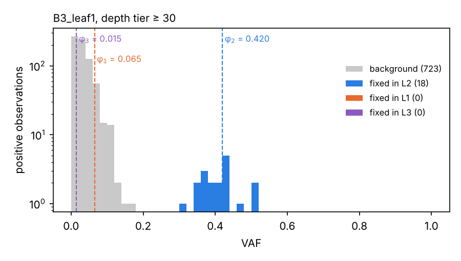
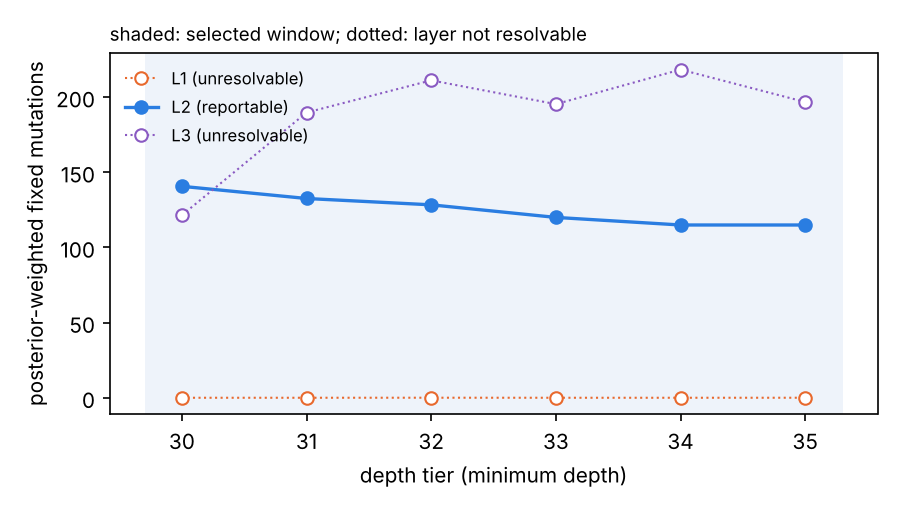
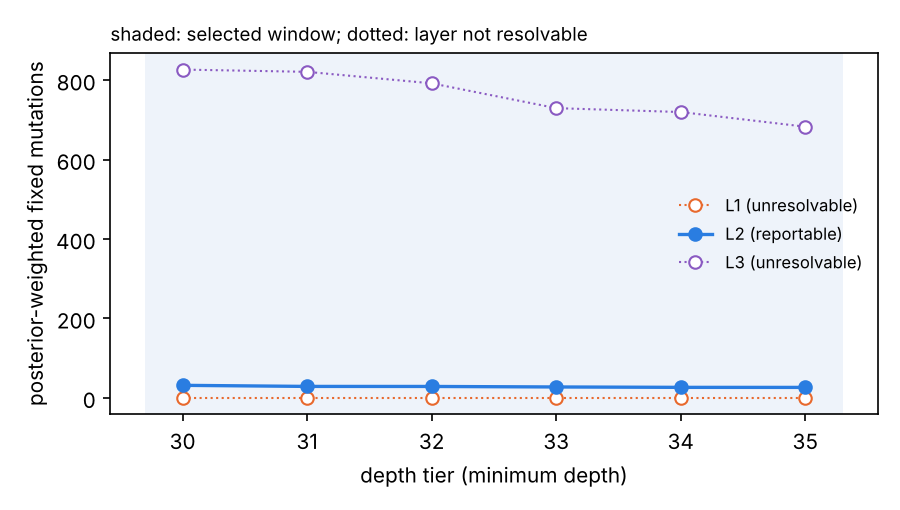

vafSOMA identifies somatic mutations that are fixed in one meristem layer of a plant, assigns them to that layer,
counts them per organ and tells you which layers the data can resolve. Its input is bulk sequencing of organs, such as
leaves or fruits, and it starts from tables of candidate variants with read counts per organ. This tutorial takes about **45 minutes**:

1. Install and first run (10 min)
2. Read the results (15 min)
3. Replicate organs (10 min)
4. Your own data (10 min)

Every command was tested with vafSOMA 0.4.3 on Linux. Copy the commands into a terminal in the order shown.

> **What you need:** Linux or macOS, Python 3.10 or newer, and `git`. On Windows, use WSL.

---

# Part 1. Install and first run

Goal: install vafSOMA and run it on a small simulated tree.

## 1.1 Get the code

```bash
git clone https://github.com/jlab-code/vafSOMA.git
git clone https://github.com/jlab-code/vafSOMA-tutorial.git
cd vafSOMA
python3 -m venv .venv && source .venv/bin/activate      # optional: a private Python environment
pip install .
vafsoma version
```

Expected output (version numbers of the libraries will differ):

```text
{
  "vafsoma": "0.4.3",
  "python": "3.11.9",
  ...
}
```

The tutorial scripts used in Parts 2 and 3 are in `../vafSOMA-tutorial/scripts/`. They need only pandas and
matplotlib, which vafSOMA installs.

## 1.2 The example tree

`vafSOMA_inputs/examples/example_tree/` holds a data set simulated with simSOMA, so that the true mutations are known.

| Property | Value |
|---|---|
| Tree | three branch tips (B1, B3, B4), three leaves per tip, formed about one week apart |
| Samples | bulk leaves, mean depth 60× |
| Leaf composition | L1 0.13, L2 0.84, L3 0.03 (fraction of the leaf's DNA from each layer) |
| Files | `vaf_tables.zip`, `effective_genome_size.tsv`, `root2tip.tsv`, `replicate_groups.tsv`; the truth in `truth_layer_carriers.csv.gz` |

`vaf_tables.zip` contains one table per minimum depth (30× to 35×). Each table lists every candidate site, with one
row per site and leaf, including leaves without alternative reads:

```text
sample,chrom,pos,ref,alt,ref_depth,alt_depth,DP,site_id,VAF
B1_leaf1,chr1,10222,A,T,38,0,38,L1:1036033718889141578,0.0
```

(`site_id` exists only in simulated data and lets us compare with the truth later.)

## 1.3 Check and run

A run is described by a JSON configuration. Look at `vafSOMA_configs/example_01_per_leaf.json`: it names the input
files and the leaf composition. Check it, then run it:

```bash
vafsoma check vafSOMA_configs/example_01_per_leaf.json
vafsoma run vafSOMA_configs/example_01_per_leaf.json
```

`check` prints what will be run:

```text
configuration OK: vafSOMA_configs/example_01_per_leaf.json
  experiment: example_01_per_leaf
  ...
  model: bulk, layer proportions L1=0.13,L2=0.84,L3=0.03; unphased; replicate groups: no
```

The run takes about five minutes on two cores and ends with a list of output files in
`vafSOMA_output/example_01_per_leaf/`.

> **Quick settings.** The example configurations use 8 EM starts, so that they run quickly. For real data keep the
> default (16).

---

# Part 2. Read the results

Goal: see which layers the data resolve, how many fixed mutations each organ carries, and look at the calls.

## 2.1 The window summary

The overview is `05_selected_window_summary.csv`, with one row per tree. Print the key columns:

```bash
python3 - <<'EOF'
import pandas as pd
s = pd.read_csv("vafSOMA_output/example_01_per_leaf/05_selected_window_summary.csv").iloc[0]
print("depth window:", s.selected_window_start, "-", s.selected_window_end, "| units:", s.n_units, s.unit_type)
for L in ("L1", "L2", "L3"):
    print(f"{L}: fixed (posterior-weighted) {s[f'mean_posterior_weighted_{L}_count']:.1f}  "
          f"recall {s[f'{L}_model_implied_recall']:.2f}  {s[f'{L}_status']}")
print("fit warning:", s.fit_warning)
EOF
```

```text
depth window: 30 - 35 | units: 9 organ
L1: fixed (posterior-weighted) 0.0  recall 0.00  unresolvable
L2: fixed (posterior-weighted) 125.2  recall 1.00  reportable
L3: fixed (posterior-weighted) 188.8  recall 0.00  unresolvable
fit warning: True
```

How to read this:

- **Depth window.** vafSOMA fits every depth tier separately and summarises the calls over a window of consecutive
  tiers in which they are stable (here 30× to 35×).
- **Fixed mutations.** The posterior-weighted count: the sum, over the candidate sites of each leaf, of the probability
  that the site is fixed in the layer, added over the nine leaves and averaged over the tiers of the window. Per leaf
  and tier the counts are in `16_fixed_counts_by_unit_tier.csv`.
- **Model-implied recall.** The probability that a mutation truly fixed in a layer is assigned to that layer by the
  fitted model. Below 0.5 the layer is flagged `unresolvable`. A layer is also flagged when its expected VAF lies below
  the 95% quantile of the fitted background (`14_layer_resolvability.csv`, column `mean_background_quantile_vaf`;
  here 0.063). Such a component can absorb background sites and reach a high recall although it counts no mutations.
- **Status.** Counts and calls of unresolvable layers should not be interpreted. Here L3 has a larger count than L2,
  yet a recall of 0: at a VAF of 0.015 its component lies inside the background of sequencing errors and other
  artefacts, so its posterior mass comes from background sites, not from L3 mutations. L1 (expected VAF 0.065) is also
  unresolvable at 60×.
- **Fit warning.** The background has more sites in the VAF bin 0.025–0.05 than the model expects (16% more; file
  `15_vaf_fit_check_summary.csv`). The simulated background is gamma-shaped rather than exponential. In the
  simulations of the vafSOMA paper, warnings were common, especially at low depth, and did not mark data sets with
  less accurate counts. Use the resolvability flag, not the warning, to decide which counts to report; a warning is a
  reason to look at the VAF spectrum (2.2). Here L2 lies far from the background.

> **Only L2 here.** At this leaf composition the data resolve L2 only. A count of "all fixed mutations" would mix
> real L2 mutations with background mass assigned to L1 and L3.

## 2.2 Where the calls come from

The tutorial script `plot_vaf_spectrum.py` draws the VAF spectrum of one leaf at one depth tier, coloured by
vafSOMA's call, with the expected VAF of each layer, φ_k (half the layer's contribution, for heterozygous mutations):

```bash
python3 ../vafSOMA-tutorial/scripts/plot_vaf_spectrum.py vafSOMA_output/example_01_per_leaf \
    vafSOMA_inputs/examples/example_tree/vaf_tables.zip B3_leaf1 30 vaf_spectrum_B3_leaf1.png
```

<a href="images/vaf_spectrum_B3_leaf1.png"></a>

How to read it:

- The grey mass at low VAF is the background, positive observations from errors and artefacts that Mutect2 retains.
- The blue sites cluster around φ₂ = 0.42 and are called fixed in L2.
- φ₁ = 0.065 and φ₃ = 0.015 lie inside the background, which is why L1 and L3 are unresolvable: φ₃ lies below the
  background's 95% quantile (0.063), and φ₁ just above it, but its recall is 0.

## 2.3 Counts across depth tiers

Each depth tier keeps only the sites at which every leaf reaches that depth, so the counts change gradually from tier
to tier. Plot the posterior-weighted count of each layer per tier:

```bash
python3 ../vafSOMA-tutorial/scripts/plot_layer_counts.py vafSOMA_output/example_01_per_leaf layer_counts_per_leaf.png
```

<a href="images/layer_counts_per_leaf.png"></a>

The L2 count declines slowly with the minimum depth, as fewer sites pass the depth filter. The same plot is written to
`diagnostic_plots/`.

## 2.4 The calls

| File | One row per | Use |
|---|---|---|
| `07_variant_calls_selected_window.csv` | variant | stable fixed call and layer over the window |
| `08_organ_variant_calls_window.csv` | variant and organ | `organ_calling_status`, e.g. `called_fixed_L2` |
| `09_candidate_fixed_mutations_example.csv` | candidate fixed mutation | wide table with the status in every organ |

```bash
python3 - <<'EOF'
import pandas as pd
c = pd.read_csv("vafSOMA_output/example_01_per_leaf/09_candidate_fixed_mutations_example.csv")
print(c.calling_status.value_counts().to_string())
print(c[["variant", "most_likely_layer", "n_organs_called_fixed", "organs_called_fixed"]].head(3).to_string(index=False))
EOF
```

```text
called_fixed_L2       52
evaluated_unstable     4
      variant most_likely_layer  n_organs_called_fixed                                   organs_called_fixed
chr1:62101A>T                L2                      3                            B3_leaf1;B3_leaf2;B3_leaf3
chr1:63760A>T                L2                      6 B3_leaf1;B3_leaf2;B3_leaf3;B4_leaf1;B4_leaf2;B4_leaf3
...
```

The first candidate, `chr1:62101A>T`, is called fixed in L2 in all three leaves of B3 and absent from the other tips:
a mutation that arose in the meristem of branch B3.

## 2.5 Compare with the truth

Because the example is simulated, we can check the counts. `compare_with_truth.py` compares, per leaf, the true number
of L2 mutations fixed in the leaf (present in all its L2-derived cells) with vafSOMA's posterior-weighted count:

```bash
python3 ../vafSOMA-tutorial/scripts/compare_with_truth.py vafSOMA_output/example_01_per_leaf \
    vafSOMA_inputs/examples/example_tree
```

```text
          true fixed L2  vafSOMA (posterior-weighted)
leaf
B1_leaf1              2                           7.9
B1_leaf2              2                          13.9
...
B4_leaf3             11                          19.0

total: true 96, vafSOMA 140.5
```

vafSOMA counts about 45% more than the truth. Every extra call is a real L2 mutation, but one that is carried by only
50–90% of the leaf's cells. At 60× such a mutation (VAF about 0.34) cannot be told apart from a fixed one (0.42).
Most of these mutations are carried by part of the cells in each leaf of the tip: they arose in the branch meristem
but were not fixed among its stem cells when the leaves formed. Most are at B1 (29 of 45 extra calls). A single organ
cannot separate them from fixed mutations. Part 3 shows how replicate organs help.

---

# Part 3. Replicate organs

Goal: analyse the three leaves of each tip jointly, as samples of one branch meristem.

## 3.1 Replicate groups

A mutation fixed in the branch meristem is present in every leaf the branch forms; a mutation from a leaf's founder
cells is present in that leaf only. `replicate_groups.tsv` declares which leaves belong together:

```text
tree     sample    group
example  B1_leaf1  B1
example  B1_leaf2  B1
...
```

`example_02_replicate_groups.json` is the same configuration as before plus this one line:

```json
"replicate_groups": "vafSOMA_inputs/examples/example_tree/replicate_groups.tsv"
```

With replicate groups, vafSOMA fits one latent state per variant and group, so a mutation is called fixed in the
group only if the reads of all leaves support it.

```bash
vafsoma run vafSOMA_configs/example_02_replicate_groups.json
```

## 3.2 Compare

```bash
python3 ../vafSOMA-tutorial/scripts/compare_with_truth.py vafSOMA_output/example_02_replicate_groups \
    vafSOMA_inputs/examples/example_tree
python3 ../vafSOMA-tutorial/scripts/plot_layer_counts.py vafSOMA_output/example_02_replicate_groups layer_counts_groups.png
```

```text
                           true fixed L2  vafSOMA (posterior-weighted)
tip (fixed in all leaves)
B1                                     2                           6.5
B3                                    13                          13.8
B4                                    11                          11.0

total: true 26, vafSOMA 31.3
```

<a href="images/layer_counts_groups.png"></a>

- The count is now about 20% above the number of mutations fixed in all three leaves (31 versus 26), compared with
  45% too many for single leaves. The remaining excess is at B1, where some mutations are carried by most, but not
  all, cells of every leaf.
- The window summary now counts per tip (`unit_type` and `fixation_criterion` are `replicate_group`): 28.0
  posterior-weighted L2 mutations over the three tips, that is 9.3 per tip, compared with 13.9 per leaf before
  (125.2 over nine leaves), because most mutations that are not fixed in the meristem are no longer counted.
- L3 is still unresolvable. In `13_group_variant_calls_window.csv` you will find several hundred sites `called_fixed_L3`.
  These are artefacts shared by all leaves of a tip that the L3 component (VAF 0.015) absorbs. Calls in an
  unresolvable layer are not meaningful.

> **Why replicates matter.** Mutations fixed in the branch meristem are the ones carried by its stem cells and by
> everything the branch forms later. Single-organ counts also include mutations fixed in the organ only. Two or three
> organs formed close in time on the same branch remove most of this excess, which matters for any estimate built on
> the counts, such as a mutation rate.

---

# Part 4. Your own data

Goal: prepare your input tables and set up a vafSOMA run. vafSOMA starts from candidate somatic variants that you have
called beforehand; the full specification is in `vafSOMA_docs/inputs.md`.

## 4.1 Prepare the input tables

You need three tables per tree. Templates are in `vafSOMA_inputs/templates/`.

**Variant tables, one per depth tier.** For each minimum depth d (for example 20, 21, …, 40), every candidate site at
which **all organs** have a depth of at least d, with one row per site and organ:

```text
sample    chrom  pos    ref  alt  ref_depth  alt_depth  DP  VAF
B1_leaf1  chr1   10222  A    T    38         0          38  0.0
B1_leaf2  chr1   10222  A    T    55         0          55  0.0
B1_leaf3  chr1   10222  A    T    47         3          50  0.06
```

Name the files `<tree>_dp_<d>_vaf.txt` (or add `tree` and `depth_filter` columns) and put them in a folder or a
`.zip` archive. Three rules matter:

- **Every organ at every site, zeros included.** Organs without alternative reads need a row with `alt_depth = 0`.
  A joint multi-sample call provides this; separate tumour–normal calls per organ do not.
- **No allele-frequency cutoff.** Include all candidates that passed the caller's filters. vafSOMA models the low-VAF
  background of errors and artefacts and needs to see it.
- **Germline removed.** Call against a matched normal: an organ from an early-diverging part of the plant, such as a
  basal branch, so that mutations shared with it are excluded as germline.

For the vafSOMA paper we called all organs of a plant jointly with GATK Mutect2 against the matched normal, with
emission thresholds of zero, filtered with FilterMutectCalls, kept PASS biallelic SNVs and took `ref_depth` and
`alt_depth` from FORMAT/AD and `DP` from FORMAT/DP. The exact settings are listed in `vafSOMA_docs/inputs.md`.

**Effective genome size.** For each d, the number of reference positions (A, C, G or T) at which every organ has a
depth of at least d, counting reads that pass the caller's read filters (for Mutect2, mapping quality ≥ 20):

```text
tree    depth_filter  effective_genome_size
treeA   20            201345221
```

**Root-to-tip lengths.** The age (or path length) of each organ, measured from the point where its lineage diverged
from the normal. vafSOMA uses them to choose the depth window and writes them with the counts:

```text
sample    root2tip_length
B1_leaf1  10.2
```

## 4.2 The run configuration

```bash
vafsoma template run > my_analysis.json
```

Point `input.variants`, `input.effective_genome_size` and `input.root2tip` at your tables, then set:

| Setting | Meaning | How to choose |
|---|---|---|
| `input.root2tip` | table `sample  root2tip_length` | the age of each organ (or its distance from the base), **measured from the point where its lineage diverged from the normal**; mutations before that point are excluded as germline |
| `input.control_organs` | the normal(s), `{tree: organ}` | only if the normal appears in the tables; flagged in the outputs and excluded from the count sums |
| `input.replicate_groups` | table `tree  sample  group` | organs of one branch tip formed close in time |
| `model.layer_proportions` | each layer's share of the organ's DNA | from anatomy or cell-type data for your organ; the template holds a typical leaf (L1 0.13, L2 0.84, L3 0.03) |
| `model.organ_layer_proportions` | organ-specific shares | only if organs differ in composition; organs not listed use `model.layer_proportions` |
| `observation` | sequencing error e and read concentration k | calibrated for your data set beforehand (vafSOMA does not estimate them); for the apricot data of the vafSOMA paper, e = 3 × 10⁻⁴ and k = 140. The default (e = 0, no concentration) is the model of vafSOMA 0.3.0 |
| `screen.all_organs` | remove candidates with alternative reads in every non-control organ before the fit | only if no lineage after the divergence from the normal is shared by all sampled organs (e.g. organs from different main limbs); needs `input.control_organs` and at least three other organs; otherwise it removes true mutations |

For the apricot data, the observation section reads:

```json
"observation": {"read_error": 3e-4, "read_concentration": 140}
```

The optional keys `preset`, `config_sha256` and `source_version` only record where the values came from; they are
written to `00_run_metadata.json` and not used in the fit. With `screen.all_organs: true`, the removed sites are listed in `18_all_organs_screened_sites.csv`.

Then check and run as in Part 1. Use `sensitivity.layer_proportions: true` to see how the counts change when the assumed
composition is off by ±10% and ±20%.

## 4.3 What to report

- The calls and posterior-weighted counts of each layer with `status = reportable`.
- Which layers are unresolvable, and whether the fit check warned.
- The observation-model parameters (e and k) and whether the all-organs screen was used.
- Whether the counts come from single organs or replicate groups, and how the root-to-tip lengths were measured.

> **Mutation rates.** vafSOMA does not compute rates. `16_fixed_counts_by_unit_tier.csv` and
> `17_unit_posteriors_by_tier.csv.gz` contain what a rate calculation needs: the counts per organ (or group) and
> depth tier, the posteriors behind them, the effective genome size of each tier and the root-to-tip length of each
> organ (`vafSOMA_docs/outputs.md`).
- For layer-enriched samples (e.g. fruit flesh for L2), set `model.layer_specific_seq: true` and give the purity
  (`active_layer_proportion`).

---

# Part 5. Reference

## Commands

| Command | What it does |
|---|---|
| `vafsoma run CONFIG` | fit, call and count fixed mutations |
| `vafsoma check CONFIG` | validate a configuration and its input files |
| `vafsoma template run` | print a complete run configuration |
| `vafsoma version` | versions |

## Key output files

| File | Content |
|---|---|
| `05_selected_window_summary.csv` | selected window, counts per layer, resolvability and fit warning |
| `16_fixed_counts_by_unit_tier.csv` | counts per organ or group and depth tier, with genome size and length |
| `09_candidate_fixed_mutations_<tree>.csv` | candidate fixed mutations, status per organ |
| `13_group_variant_calls_window.csv` | replicate-group calls |
| `14_layer_resolvability.csv` | model-implied recall per layer and the background condition |
| `18_all_organs_screened_sites.csv` | sites removed by the all-organs screen (only with `screen.all_organs`) |
| `15_vaf_fit_check_summary.csv` | VAF fit check |

Inputs: `vafSOMA_docs/inputs.md`. All output files: `vafSOMA_docs/outputs.md`. All settings: `vafSOMA_docs/configuration.md`.

## Troubleshooting

| Problem | Solution |
|---|---|
| `vafsoma: command not found` | Activate the environment in which you ran `pip install .` |
| `vafsoma: error: unknown configuration key: ...` | Keys are checked strictly; compare with `vafsoma template run` |
| All layers but one are `unresolvable` | Expected when a layer's VAF (half its share of the organ) is close to the background. More depth, a different organ, or layer-enriched samples help |
| `fit_warning = True` | The VAF spectrum departs from the fitted mixture, often because the background is not exponential. Common at low depth; check the spectrum (2.2), and report only layers flagged `reportable` |
| `all-organs screen: tree ... has no control organ` | Set `input.control_organs`, or switch the screen off |
| The L2 count per organ is higher from single organs than per group from replicate groups | Expected: single organs also count mutations that are not fixed in the branch meristem (Part 3) |
| Warning `configuration key bootstrap was removed in vafSOMA 0.3.0` | Configuration files of 0.2.x still run; delete the key |
| `Variant table is missing required columns: [...]` | The tables need `sample, chrom, pos, ref, alt, ref_depth, alt_depth` (see 4.1 and `vafSOMA_docs/inputs.md`) |
| `Could not infer depth_filter from file name ...` | Name the files `<tree>_dp_<d>_vaf.txt` or add a `depth_filter` column |

## Citation

If you use vafSOMA, please cite the vafSOMA paper and the software (`CITATION.cff` in the vafSOMA repository).
